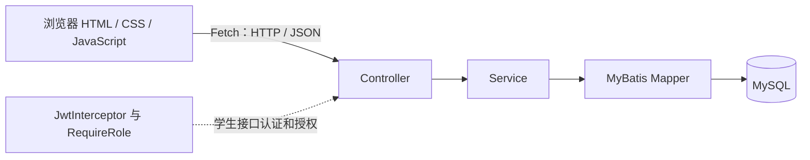

# 学生管理系统

基于 Spring Boot、MyBatis 与原生 HTML / CSS / JavaScript 的学生信息管理项目，包含用户注册与登录、JWT 身份认证、角色权限控制，以及学生信息查询和维护。

本项目用于 Java Web 全栈开发实践与实习作品展示，围绕学生档案管理场景，串联数据库访问、业务校验、REST API、认证授权和前端交互。当前实现面向本地学习与演示，不代表已经完成生产环境部署或安全加固。

## 目录

- [技术栈](#技术栈)
- [已实现功能](#已实现功能)
- [项目目录结构](#项目目录结构)
- [系统架构](#系统架构)
- [核心业务流程](#核心业务流程)
- [数据库说明](#数据库说明)
- [API 接口文档](#api-接口文档)
- [本地运行指南](#本地运行指南)
- [项目截图](#项目截图)
- [验证与当前限制](#验证与当前限制)
- [后续优化方向](#后续优化方向)

## 技术栈

| 分类 | 实际使用的技术 | 用途 |
| --- | --- | --- |
| Java | Java 21 | 后端开发；版本来自 `pom.xml` |
| Web 框架 | Spring Boot 4.1.1、Spring MVC | REST 接口、依赖注入、应用启动 |
| 数据访问 | MyBatis Spring Boot Starter 4.0.0 | Mapper 注解 SQL、动态查询 |
| 数据库 | MySQL、MySQL Connector/J | 用户与学生数据存储；仓库未注明 MySQL 服务端版本 |
| 参数校验 | Jakarta Validation、Spring Boot Validation | 用户名、密码、学生姓名与年龄校验 |
| 认证 | JJWT 0.12.5 | JWT 签发、签名验证与过期校验 |
| 密码处理 | Spring Security Crypto、BCrypt | 密码哈希存储与登录匹配；未使用完整 Spring Security 过滤器链 |
| 接口文档 | springdoc-openapi 3.1.1、Swagger UI | OpenAPI 文档及 Bearer 认证调试 |
| 前端 | HTML、CSS、原生 JavaScript、Fetch API | 登录页、学生管理、弹窗和响应式布局 |
| 构建与测试 | Maven Wrapper、JUnit Jupiter、Spring Boot Test | 构建与应用上下文测试 |

`pom.xml` 另声明了 Lombok 依赖与注解处理器配置；当前实体及 DTO/VO 的访问方法主要由代码显式编写。

## 已实现功能

### 学生管理

- 学生详情查询、新增、修改、删除。
- 分页查询：默认第 1 页，每页 10 条；后端限制每页数量为 1～100。
- 按姓名进行包含匹配：SQL 使用 `LIKE CONCAT('%', name, '%')`。
- 前端支持搜索、重置、上一页与下一页。
- 修改前调用详情接口，自动回填姓名、年龄、性别和邮箱。
- 新增、修改通过弹窗完成，取消不提交；删除前进行二次确认。

### 用户与权限

- 后端提供注册、登录接口；**当前前端仅提供登录界面，没有注册页面**。
- 注册前检查用户名是否已存在，使用 BCrypt 编码密码后存储。
- 登录成功返回用户名、角色和 JWT，不返回密码。
- 学生接口要求 Bearer Token；新增、修改、删除进一步要求 `ADMIN` 角色。
- `USER` 可查询学生，前端隐藏新增、修改、删除入口。
- 权限最终由后端 `JwtInterceptor` 与 `@RequireRole` 校验，前端隐藏入口只是交互辅助。
- 前端退出时清除本地登录状态和学生内容；收到认证失效响应时要求重新登录。

### 工程与界面

- Controller / Service / Mapper 分层，统一 `Result` 响应与 `PageResult` 分页对象。
- `LoginDTO`、`RegisterDTO` 接收登录和注册输入，`LoginVO` 封装登录输出；学生写入接口直接使用 `Student`，尚未单独拆分学生 DTO。
- `GlobalExceptionHandler` 统一处理参数校验异常及自定义业务异常。
- 浅色卡片式管理界面、用户名与角色显示、响应式布局、加载提示、空数据提示、成功/失败反馈及防重复提交。
- 后端返回的学生内容通过文本节点展示，避免直接作为 HTML 拼接。

## 项目目录结构

以下为主要源码与工程文件，省略 Git 内部文件和构建输出：

```text
student-management/
├── README.md
├── pom.xml
├── mvnw / mvnw.cmd                  # Maven Wrapper 启动脚本
├── .mvn/wrapper/
│   └── maven-wrapper.properties     # Maven 分发配置
├── .gitignore
├── frontend/
│   ├── index.html                  # 登录、列表、学生表单弹窗
│   ├── style.css                   # 管理界面与响应式样式
│   └── script.js                   # Fetch 请求、JWT 状态、业务交互
├── text.http/                      # 手动接口调试请求文件
│   ├── test_register.http
│   ├── test_login.http
│   ├── test-Post.http
│   ├── POST.http / PUT.http / DELETE.http
│   └── Jwt.http / 权限.http
└── src/
    ├── main/
    │   ├── java/com/example/student_management/
    │   │   ├── StudentManagementApplication.java
    │   │   ├── Student.java / User.java
    │   │   ├── controller/          # StudentController、UserController
    │   │   ├── service/             # StudentService、UserService
    │   │   ├── mapper/              # StudentMapper、UserMapper，注解式 SQL
    │   │   ├── dto/                 # LoginDTO、RegisterDTO
    │   │   ├── vo/                  # LoginVO
    │   │   ├── common/              # Result、PageResult
    │   │   ├── exception/           # BusinessException、GlobalExceptionHandler
    │   │   ├── interceptor/         # JwtInterceptor
    │   │   ├── annotation/          # RequireRole
    │   │   ├── enums/               # Role：USER、ADMIN
    │   │   ├── utils/               # JwtUtil
    │   │   └── config/              # WebConfig、OpenApiConfig
    │   └── resources/
    │       └── application.properties
    └── test/java/com/example/student_management/
        └── StudentManagementApplicationTests.java
```

## 系统架构



- **Controller**：接收请求、执行参数校验，调用业务层并返回 JSON。
- **Service**：处理登录与注册校验、密码匹配、学生存在性检查、分页参数检查。
- **Mapper**：使用 MyBatis 注解与参数绑定执行 SQL，分页通过 `LIMIT / OFFSET` 实现。
- **MySQL**：保存 `student` 和 `user` 表中的数据。
- **前端**：静态页面与后端分开运行，通过 Fetch 调用当前固定的 `http://localhost:8080` API 地址。

`WebConfig` 将认证拦截器应用于 `/students/**`；用户注册与登录不经过该学生接口拦截器。跨域配置允许 `http://localhost:5500` 和 `http://127.0.0.1:5500`。

## 核心业务流程

### 注册

1. 客户端向 `POST /users/register` 发送用户名和密码。
2. `RegisterDTO` 校验两项均非空。
3. `UserService` 查询用户名，重复时返回业务错误。
4. BCrypt 编码密码，`UserMapper` 写入 `username`、`password`。

注册接口不接收角色，插入 SQL 也不写入 `role`。普通用户角色是否自动设为 `USER`，依赖实际数据库的列默认值；仓库没有 DDL，无法确认该默认值。管理员账号需由已有数据库或受控初始化流程提供，项目没有角色分配接口。

### 登录与 JWT

1. `POST /users/login` 接收 `LoginDTO`。
2. 根据用户名查询用户，并通过 BCrypt 验证密码。
3. `JwtUtil` 生成 JWT：主体为用户名，包含 `role`，有效期为 **1 小时**。
4. 返回 `LoginVO`：`username`、`role`、`token`。
5. 前端在 `localStorage` 保存登录信息，学生接口请求携带 `Authorization: Bearer <token>`。
6. 后端验证签名与有效期后，将用户名和角色写入请求属性。

退出登录只清除浏览器本地状态，后端没有退出接口或 Token 撤销机制，已签发 Token 在过期前仍可能有效。

### 角色控制与学生管理

- 查询接口：具有有效 JWT 的 `USER` 和 `ADMIN` 均可访问。
- 写入接口：方法标注 `@RequireRole("ADMIN")`，拦截器读取 Token 中的角色并校验。
- 缺少或无效 Token 返回 HTTP 401；角色不符返回 HTTP 403。
- 新增与修改校验姓名非空、年龄至少为 1；前端另要求年龄为整数并校验邮箱输入格式。
- 详情不存在、修改或删除影响行数为 0 时，业务层返回“学生不存在”错误。
- 前端写入成功后刷新当前列表；新增和删除后回到第 1 页。

## 数据库说明

默认连接目标为本地 MySQL 的 `student_management` 数据库，连接信息可通过环境变量覆盖。

**仓库目前没有建表 DDL、数据库初始化 SQL、数据库导出文件或迁移脚本。** 下表仅依据实体字段与 Mapper SQL 整理，不能据此确认实际列类型、长度、索引、可空性、主键、自增或默认值。

### `student` 表

| 列名 | Java 类型 | 代码中的用途与校验 |
| --- | --- | --- |
| `id` | `Integer` | 详情查询、修改与删除定位；新增 SQL 不写入此列 |
| `name` | `String` | 学生姓名；`@NotBlank`；支持模糊查询 |
| `age` | `Integer` | 年龄；`@Min(1)`，后端没有 `@NotNull` |
| `gender` | `String` | 性别；前端提供“男”“女”，后端没有枚举约束 |
| `email` | `String` | 邮箱；前端使用 email 输入框，后端没有 `@Email` |

### `user` 表

| 列名 | Java 类型 | 代码中的用途 |
| --- | --- | --- |
| `id` | `Integer` | 用户标识；注册 SQL 不写入此列 |
| `username` | `String` | 登录查询与注册重复检查 |
| `password` | `String` | 存储 BCrypt 密码哈希，不应存储明文 |
| `role` | `Role` | `USER` / `ADMIN`；登录时用于生成 JWT |

运行前需取得真实建表 SQL，并核对 `id` 的生成机制、用户名唯一约束、密码字段容量及 `role` 默认值。代码中的注册重复检查不能替代数据库唯一约束。本文不提供未经验证的建表脚本，也不包含真实密码或 JWT 密钥。

## API 接口文档

默认后端地址：`http://localhost:8080`。JSON 请求应设置 `Content-Type: application/json`。

| 方法 | 路径 | 作用 | 请求参数或 JSON 字段 | 权限 |
| --- | --- | --- | --- | --- |
| POST | `/users/register` | 注册用户 | `username`、`password` | 无需登录 |
| POST | `/users/login` | 登录 | `username`、`password` | 无需登录 |
| GET | `/students` | 分页与姓名搜索 | 查询参数 `page=1`、`size=10`、可选 `name` | USER / ADMIN |
| GET | `/students/{id}` | 查询详情 | 路径参数 `id` | USER / ADMIN |
| POST | `/students` | 新增学生 | `name`、`age`、`gender`、`email` | ADMIN |
| PUT | `/students` | 修改学生 | `id`、`name`、`age`、`gender`、`email` | ADMIN |
| DELETE | `/students/{id}` | 删除学生 | 路径参数 `id` | ADMIN |

所有学生接口需携带：

```http
Authorization: Bearer <登录接口返回的 token>
```

### 返回结构

统一响应为 `code`、`message`、`data`。注册及学生新增、修改、删除成功时，`data` 为 Mapper 返回的影响行数，不是新建对象或 ID。

以下是**结构示例，不是真实用户或数据库查询结果**：

```json
{
  "code": 200,
  "message": "success",
  "data": {
    "records": [],
    "total": 0,
    "page": 1,
    "size": 10,
    "totalPages": 0
  }
}
```

登录成功时 `data` 包含 `username`、`role`、`token`；详情查询时 `data` 为学生对象。

| 业务码 | 主要场景 |
| --- | --- |
| 200 | 请求成功 |
| 400 | 输入校验失败、分页参数不合法、用户名重复或登录信息错误 |
| 401 | 学生接口缺少 Token，或 Token 无效/过期 |
| 403 | 无学生写入权限 |
| 404 | 学生不存在 |

注意：`GlobalExceptionHandler` 返回业务响应对象，没有显式设置 HTTP 状态码，因此其业务码不能直接当成 HTTP 状态码。认证拦截器则显式设置 HTTP 401/403。客户端应同时检查 HTTP 状态与 JSON 中的 `code`。

### Swagger / OpenAPI

后端启动成功后访问：

- [Swagger UI](http://localhost:8080/swagger-ui/index.html)
- [OpenAPI JSON](http://localhost:8080/v3/api-docs)

项目配置了名为 `bearerAuth` 的 HTTP Bearer 安全方案。先调用登录接口获取 Token，再在 Swagger UI 的 **Authorize** 中输入 Token 本身，随后调试学生接口。OpenAPI 全局声明了 Bearer 认证，但注册和登录在实际后端中无需认证。

## 本地运行指南

### 1. 环境准备

- JDK 21。
- 可用的 MySQL 服务与真实项目表结构；仓库未锁定 MySQL 服务端版本。
- 支持 Fetch、`dialog` 和 `localStorage` 的现代浏览器。
- Maven 可使用仓库自带 Wrapper；配置的分发版本为 Maven 3.9.16，首次运行需要下载依赖。
- 前端静态服务可使用 VS Code Live Server，或已安装的 Python 3。

### 2. 获取项目

```bash
git clone https://github.com/junhaowu57-eng/student-management.git
cd student-management
```

### 3. 准备数据库与连接配置

1. 从项目维护者或已有本地数据库取得真实建表 SQL。
2. 在个人开发数据库中导入 `student`、`user` 表，确认与上文列名一致；不要覆盖已有数据。
3. 核对账号角色为 `USER` 或 `ADMIN`，并确认密码为有效 BCrypt 哈希。
4. 使用 `DB_URL`、`DB_USERNAME`、`DB_PASSWORD` 覆盖数据库连接配置。

Windows PowerShell 示例，尖括号中的值需要在自己的终端替换，**不要把实际密码写进仓库**：

```powershell
$env:DB_URL = 'jdbc:mysql://localhost:3306/student_management?useUnicode=true&characterEncoding=utf8&serverTimezone=Asia/Shanghai&useSSL=false'
$env:DB_USERNAME = '<本地数据库用户名>'
$env:DB_PASSWORD = '<本地数据库密码>'
```

配置文件为 `src/main/resources/application.properties`。当前项目仍存在数据库密码默认配置及 `JwtUtil` 内固定签名密钥；本文不复述其值。共享或部署前应独立完成凭据审查与密钥外部化，本文档提交不修改这些业务文件。

### 4. 启动后端

在设置好数据库环境变量的同一终端、项目根目录执行：

```powershell
.\mvnw.cmd spring-boot:run
```

macOS / Linux：

```bash
./mvnw spring-boot:run
```

也可在 IDE 中以 JDK 21 运行 `StudentManagementApplication`。项目未显式配置服务端口，默认使用 8080；现有前端 API 地址固定为该端口。

可选构建命令：

```powershell
.\mvnw.cmd clean package
```

构建会执行测试，应用上下文测试可能需要可用的数据库配置。命令列于此作为运行说明，不表示已在当前环境验证构建成功。

### 5. 启动前端

推荐通过 HTTP 静态服务打开，不直接双击 HTML 文件：后端仅允许两个 5500 端口的来源，`file://` 页面可能因跨域限制无法调用 API。

方式一：使用 VS Code Live Server，确认端口为 **5500**，打开 `frontend/index.html`。

方式二：在项目根目录执行：

```bash
python -m http.server 5500 --bind 127.0.0.1 --directory frontend
```

然后访问 [学生管理页面](http://127.0.0.1:5500/index.html)。无需 npm 安装或前端打包。

### 6. 登录与检查

- 可先通过 Swagger 注册普通用户；角色初始化前提见数据库说明。
- 使用已有账号登录。普通用户验证查询、搜索、分页；管理员验证写入入口和权限。
- 只有在个人测试数据库中才执行新增、修改与删除检查。
- 若出现连接错误，检查后端是否启动、数据库是否可连接、前端是否运行在允许的来源。
- 若出现 401，重新登录；若出现 403，核对账号角色。

## 项目截图

目前仓库没有可用的真实截图，本节仅预留位置，不使用生成图或虚构学生数据作为系统截图。

| 待补充截图 | 建议文件位置 | 展示内容 |
| --- | --- | --- |
| 登录页 | `docs/images/login.png` | 登录表单与页面风格 |
| 管理员列表 | `docs/images/students-admin.png` | 学生表格、搜索、分页和操作入口 |
| 学生编辑弹窗 | `docs/images/student-modal.png` | 新增或修改表单 |
| 普通用户视图 | `docs/images/students-user.png` | 查询页面与权限差异 |

上述路径是计划位置，文件尚未创建。补充真实截图时请使用获准展示的数据，遮挡邮箱等个人信息及任何 Token，之后再添加 Markdown 图片引用。

## 验证与当前限制

- 仓库包含 `text.http/` 手动调试请求，以及一个 `contextLoads` 应用上下文测试，没有完整的自动化业务或端到端测试套件。
- 前端升级时完成过 JavaScript 语法、HTML 结构与模拟响应交互检查；模拟检查不是仓库中的持续集成测试，也不能替代真实数据库联调。
- 本 README 基于源码和配置核对，未将数据库表约束、运行命令、Swagger 页面或全部接口标记为实测通过。
- 缺少数据库初始化 SQL，新的开发环境尚不能仅凭仓库完整复现数据库。
- JWT 尚无刷新或撤销机制，签名密钥仍固定在源码中；前端使用 `localStorage` 保存 Token。
- 分页 SQL 未指定 `ORDER BY`，数据变化时分页顺序可能不稳定。
- 当前统一异常处理覆盖参数校验和业务异常，尚未统一覆盖所有数据库异常或未知异常。

## 后续优化方向

以下均为未来计划，**不属于当前已实现功能**：

1. 补充与真实数据库一致的初始化 SQL、迁移脚本与脱敏演示数据。
2. 外部化 JWT 密钥，清理配置中的敏感默认值，并审查历史提交中的凭据。
3. 完善学生 DTO、邮箱与年龄非空校验，并结合真实 DDL补充字段约束。
4. 为分页增加稳定排序，结合实际查询量评估索引。
5. 增加注册页面、受控管理员初始化与角色维护流程。
6. 增加 Token 刷新、退出撤销方案及更完整的认证安全设计。
7. 补充 Service / Mapper / 权限测试、前端端到端测试与 CI 校验。
8. 完善 HTTP 状态映射、未知异常处理与日志记录。
9. 将前端 API 地址配置化，补充 HTTPS 与部署说明。
10. 补充真实系统截图，进一步改善无障碍交互与移动端使用体验。
